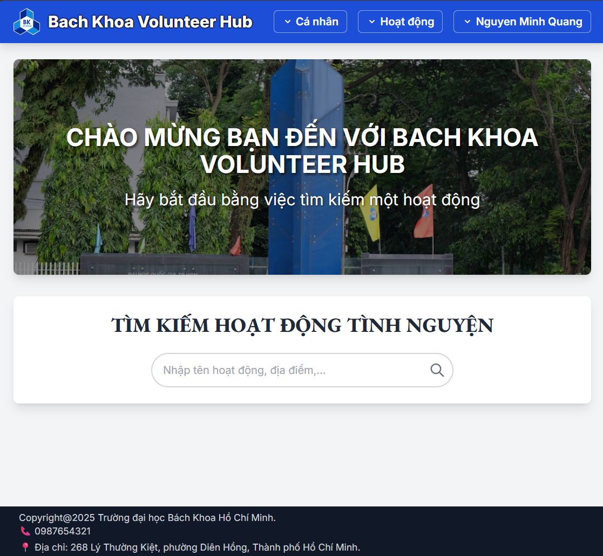

# Volunteer & Charity Platform 🌟

> **Anonymous group per course rule**: members referenced only by aliases **XA, XB, XC, XD, XE**.



A comprehensive platform designed to streamline volunteer management for charity organizations. Create campaigns, recruit volunteers, track attendance with QR codes, and generate insightful reports—all in one user-friendly system.

## ✨ Features

- **🔐 Authentication & Roles**: Secure login for Organizers and Volunteers
- **📅 Campaign Management**: Create and manage volunteer shifts and events
- **👥 Volunteer Recruitment**: Application and approval workflow with notifications
- **📱 QR-Based Attendance**: Seamless check-in/out with automatic hour computation
- **📊 Dashboard & Analytics**: Comprehensive reporting and CSV export capabilities

## 🏗️ Architecture

This project follows a **design-first, tech-agnostic** approach with:
- **Backend**: FastAPI (Python) with PostgreSQL database (hosted on NeonDB)
- **Frontend**: React + Vite with Tailwind CSS
- **Deployment**: Docker containerization with AWS ECR/EC2
- **CI/CD**: GitHub Actions for automated deployment

## 🚀 Quick Start

### Prerequisites
- Docker & Docker Compose
- Python 3.8+ (for local development)
- Node.js 16+ (for local development)

### Using Docker (Recommended)

1. **Clone the repository**
   ```bash
   git clone <repository-url>
   cd group-4-synthesis-project-volunteer-platform
   ```

2. **Start the application**
   ```bash
   docker compose up --build
   ```

3. **Access the application**
   - Frontend: http://localhost:3000
   - Backend API: http://localhost:8000
   - API Documentation: http://localhost:8000/docs

### Production Deployment

**Note**: The production deployment to AWS is currently paused due to the expiration of free tier credits (student account limitations).

The application is automatically deployed to AWS EC2 when code is pushed to the `main` branch via GitHub Actions:

#### AWS Infrastructure Setup
- **Container Registry**: Amazon ECR for storing Docker images
- **Compute**: Amazon EC2 instance running the application
- **Database**: NeonDB (serverless PostgreSQL)
- **CI/CD**: GitHub Actions workflow (`.github/workflows/deploy.yml`)

#### Deployment Process
1. **Build**: GitHub Actions builds Docker images for backend and frontend
2. **Push**: Images are pushed to Amazon ECR repositories
3. **Deploy**: SSH connection to EC2 pulls new images and restarts services
4. **Cleanup**: Old Docker images are pruned to save space

#### Production URLs (When Active)
- Frontend: `http://<EC2_PUBLIC_IP>:5173`
- Backend API: `http://<EC2_PUBLIC_IP>:8000`
- API Documentation: `http://<EC2_PUBLIC_IP>:8000/docs`

### Local Development Setup

#### Backend Setup
1. **Navigate to backend directory**
   ```bash
   cd backend
   ```

2. **Create virtual environment**
   ```bash
   # Windows
   python -m venv .venv
   .\.venv\Scripts\Activate.ps1

   # macOS/Linux
   python -m venv .venv
   source .venv/bin/activate
   ```

3. **Install dependencies**
   ```bash
   pip install -r requirements.txt
   ```

4. **Configure environment**
   Create a `.env` file in the repository root:
   ```env
   DATABASE_USER=your_user
   DATABASE_PASSWORD=your_password
   DATABASE_HOST=localhost
   DATABASE_NAME=your_db
   ```

5. **Run the backend**
   ```bash
   # From repository root
   uvicorn backend.main:app --host 0.0.0.0 --reload
   ```

#### Frontend Setup
1. **Navigate to frontend directory**
   ```bash
   cd frontend
   ```

2. **Install dependencies**
   ```bash
   npm install
   ```

3. **Start development server**
   ```bash
   npm run dev
   ```

## 📁 Project Structure

```
├── backend/                 # FastAPI backend
│   ├── main.py             # Application entry point
│   ├── requirements.txt    # Python dependencies
│   ├── Dockerfile          # Backend container config
│   ├── models/             # Database models
│   ├── routes/             # API endpoints
│   ├── controllers/        # Business logic
│   └── tests/              # Backend tests
├── frontend/               # React frontend
│   ├── src/
│   │   ├── components/     # Reusable UI components
│   │   ├── pages/          # Page components
│   │   ├── context/        # React context providers
│   │   └── api/            # API client
│   ├── package.json        # Node dependencies
│   └── Dockerfile          # Frontend container config
├── docker-compose.yaml     # Multi-container setup
└── README.md              # This file
```

## 🧪 Testing

### Backend Tests
```bash
cd backend
pytest
```

### Frontend Tests
```bash
cd frontend
npm run lint
```

## 📋 Development Guidelines

### Repository Rules (5 members)
- **Aliases only** (no real names): XA (PM/BA), XB (Backend lead), XC (Frontend lead), XD (QA/DevOps), **XE (UX/UI)**
- **Weekly commits**: each member ≥1 update/week
- **Branching**: `main` (protected) + short-lived feature branches (`feat/...`, `fix/...`, `docs/...`)
- **Conventional Commits**: `feat:`, `fix:`, `docs:`, `chore:`, `refactor:`, `test:`
- **PR Reviews**: at least 1 reviewer; CODEOWNERS auto-assigns

## 📋 Documentation & Reports

For detailed information about development processes, results, and final reports, please refer to [`Final reports.pdf`](./Final%20reports.pdf).

##  License

This project is licensed under the terms specified in [`LICENSE`](./LICENSE).

## 🙏 Acknowledgments

Built with ❤️ by the anonymous development team: XA, XB, XC, XD, XE
